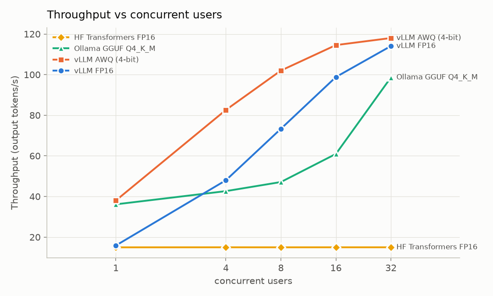

# 🩺 Medical RAG · LLM Inference Benchmark

**Hỏi đáp y khoa song ngữ Việt Anh xây từ đầu, kèm benchmark cách phục vụ LLM của chính hệ thống.**<br>
**A bilingual Vietnamese/English medical QA system built from scratch, plus a benchmark of how to serve its LLM.**


---

## Kết quả chính · Key results

| | English | Tiếng Việt |
| --- | --- | --- |
| **7.6×** | vLLM throughput vs Hugging Face Transformers at 32 concurrent users | Throughput của vLLM so với HF Transformers, 32 người dùng |
| **2.4×** | AWQ 4-bit single-user speed vs FP16, no measurable quality loss | AWQ 4-bit so với FP16 khi 1 người dùng, chất lượng không giảm |
| **0.87 → 0.96** | MRR@10 after cross-encoder reranking | MRR@10 sau khi thêm rerank |
| **98%** | Answers faithful to their cited sources | Câu trả lời bám đúng nguồn được trích dẫn |
| **22 : 1** | Prompt tokens per generated token: the workload is prefill-bound | Token đầu vào trên mỗi token đầu ra: workload bị giới hạn bởi prefill |



| Qwen2.5-7B, 1× L4 | 1 user | 8 users | 32 users | p95 TTFT, 8 users |
| --- | --- | --- | --- | --- |
| HF Transformers FP16 | 14.9 tok/s | 15.0 | 15.0 | 46 s |
| vLLM FP16 | 15.9 | 73.3 | 114.1 | 1.2 s |
| **vLLM AWQ 4-bit** | **38.1** | **102.0** | **118.0** | 1.7 s |
| Ollama GGUF Q4_K_M | 38.7 | 47.1 | 98.6 | 1.7 s |

## Cấu trúc · Structure

```
 medical-rag/   →   prompts/   →   inference-bench/
 RAG system         exact LLM      HF Transformers vs vLLM vs Ollama
 + evaluation       inputs         latency, throughput, KV cache
```

| Thư mục · Folder | Nội dung · Contents |
| --- | --- |
| [`medical-rag/`](medical-rag/) | Chunker, e5 + BM25 + RRF, reranker, FastAPI, đánh giá · evaluation |
| [`prompts/`](prompts/) | 300 prompt thật, đầu vào chung cho mọi backend · real prompts, identical input for every backend |
| [`inference-bench/`](inference-bench/) | Load generator, HF/vLLM/Ollama servers, phân tích · analysis, Colab notebook |
| [`docs/`](docs/) | Spec, kế hoạch · plan, ghi chú phỏng vấn · interview notes |

## Chạy nhanh · Quick start

```bash
cd medical-rag
pip install -e ".[data,eval,dev]"
python scripts/fetch_wikipedia.py
python -m medrag.index.build
uvicorn medrag.api.main:app --port 8080
```

Benchmark: mở · open [`inference-bench/colab/run_benchmark.ipynb`](inference-bench/colab/run_benchmark.ipynb) trên · on a Colab L4 runtime.

## Tài liệu · Docs

- [RAG: kết quả đánh giá · evaluation results](medical-rag/README.md#results)
- [Benchmark: Q1 đến Q5, profiling · Q1 to Q5, profiling](inference-bench/README.md)
- [Ghi chú phỏng vấn · Interview notes](docs/interview_answers.md)
- [Spec RAG](docs/medical_rag_spec.md) · [Spec benchmark](docs/llm_benchmark_spec.md) · [Kế hoạch · Plan](docs/PLAN.md)

## License

Code: [MIT](LICENSE). Văn bản trích từ Wikipedia (`prompts/`, `medical-rag/eval/data/`) theo · Wikipedia text under
[CC BY-SA 4.0](https://creativecommons.org/licenses/by-sa/4.0/).
