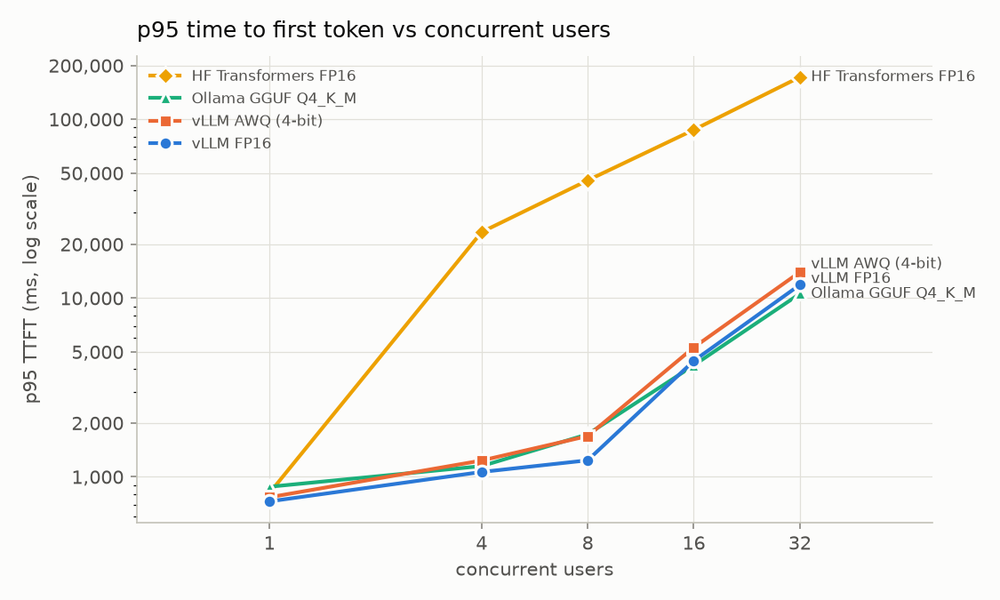
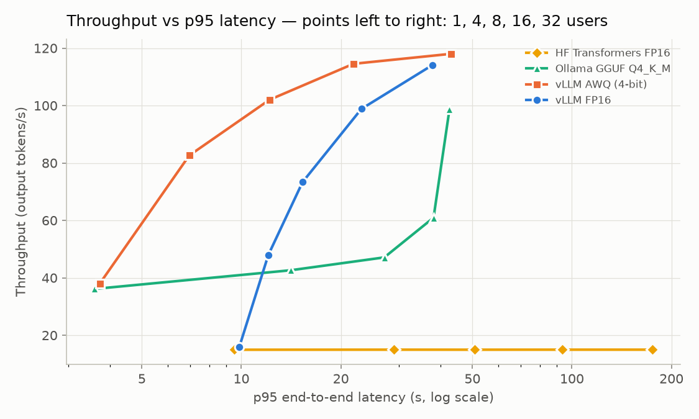
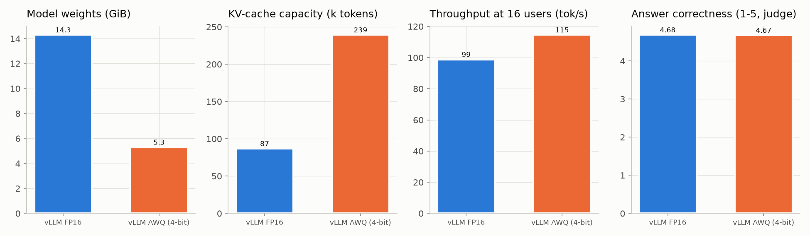
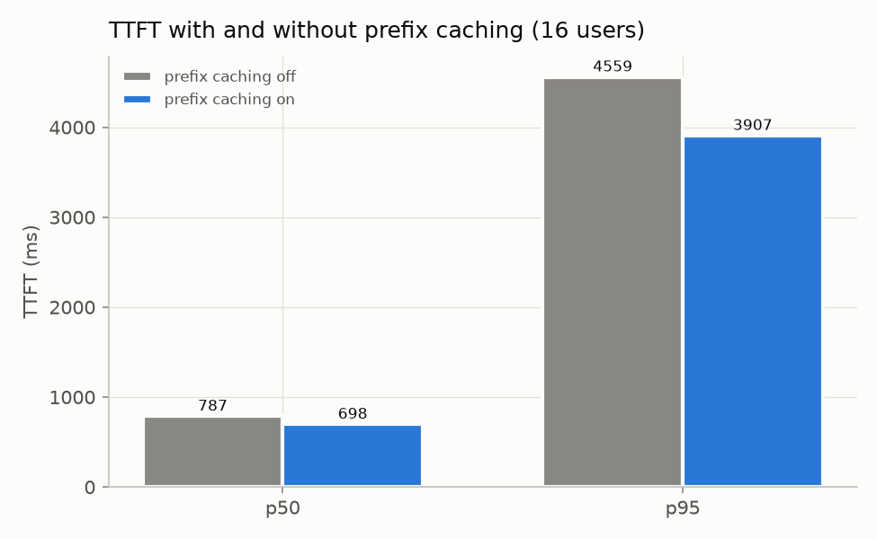
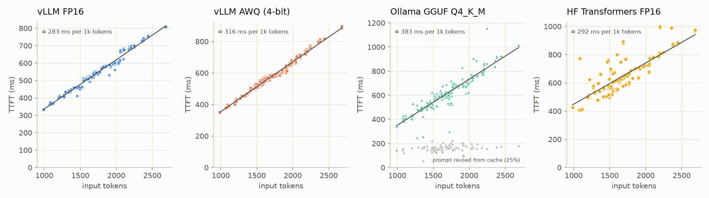

# LLM Inference Benchmark on a Medical RAG Workload

How much faster is vLLM than plain Hugging Face Transformers or Ollama for the prompts a
medical RAG system actually sends — long inputs (1–3k tokens of retrieved passages), short
answers (≤256 tokens)? This project serves one open model with each engine, replays the same
prompts at 1–32 concurrent users, and explains the differences with GPU and KV-cache data.

## Summary

Qwen2.5-7B-Instruct on one NVIDIA L4, 300 real Vietnamese/English RAG prompts
(on average ~1,700 input and ~78 output tokens per request):

- **At one user the engine barely matters, the weight format does.** vLLM FP16 is only 7% faster
  than HF Transformers (15.9 vs 14.9 tok/s); 4-bit weights are 2.4× faster (vLLM AWQ 38.1,
  Ollama 38.7 tok/s), because decoding one sequence is limited by reading the weights from memory.
- **Under load vLLM pulls away.** At 32 concurrent users vLLM FP16 delivers 7.6× the throughput of
  HF Transformers (114 vs 15 tok/s) with a p95 time to first token of 12 s instead of 172 s; at 8 users
  vLLM AWQ serves 2.2× the throughput of Ollama at the same p95 TTFT (~1.7 s).
- **AWQ is the best configuration here:** 63% smaller weights, 2.75× more KV-cache capacity, up to
  1.7× the FP16 throughput at 4 users, and no measurable quality loss (judge correctness 4.67 vs 4.68/5).
- **Prefix caching helps modestly** (−11% median, −14% p95 TTFT at 16 users): only the system prompt
  (13% of a prompt) is shared between questions.
- **Why:** this RAG workload is prefill-heavy — 22 input tokens per output token. Beyond ~16 users the
  L4 spends most of its time processing prompts, so FP16 and AWQ converge at ~1.5 requests/s.

## Questions

| # | Question | Experiment |
| --- | --- | --- |
| Q1 | At one user, how much faster is vLLM than HF Transformers and Ollama? | E1 |
| Q2 | From 1 to 32 concurrent users, how do latency and throughput change? | E2 |
| Q3 | What does AWQ 4-bit save in memory, and what does it cost in speed and quality? | E3 |
| Q4 | How much TTFT does prefix caching save with the RAG system prompt? | E4 |
| Q5 | Why? (batching, KV cache, GPU utilisation) | profiling |

## Workload

`../prompts/medical_rag_prompts.jsonl`, exported by [medical-rag](../medical-rag/): one line
per evaluation question with the exact chat messages (fixed system prompt + top-5 reranked
passages + question), 150 Vietnamese and 150 English. Retrieval is not part of the benchmark;
every engine gets byte-identical inputs.

| | min | median | p95 | max |
| --- | --- | --- | --- | --- |
| Input tokens (Qwen2.5 chat template) | 973 | 1,730 | 2,308 | 2,686 |
| Output tokens (measured, cap 256) | – | ~71 | – | 256 (≈1% of answers) |

RAG answers are short and grounded, so each request carries **~22 prompt tokens per generated
token**. That ratio drives most of the results below.

## Setup (fixed)

| | |
| --- | --- |
| GPU | 1× NVIDIA L4 24 GB, driver 580.82 (Google Colab Pro) — 72 W power limit, reached in every run |
| Model | Qwen2.5-7B-Instruct — FP16, official AWQ (Marlin kernels), GGUF Q4_K_M (Ollama) |
| Software | vLLM 0.31.0, torch 2.13 (CUDA 13), transformers 5.17, Ollama 0.40.3, Python 3.13 |
| Context | `max_model_len = 4096`; `max_tokens = 256`, `temperature = 0` |
| Repeats | 3 per configuration (median of the per-repeat values), 10 warm-up requests first; E3 once |
| Exact commands | `results/<run>/command.txt`, versions in `results/<run>/env.json` |

## How it works

```
configs/e2_vllm_fp16.yaml ─► bench.run ─► start server ─► wait for /health
                                       ├─► env.json, command.txt
                                       ├─► for each concurrency × repeat:
                                       │     warm-up → closed-loop load (bench.load_gen)
                                       │     + nvidia-smi sampler + vLLM /metrics poller
                                       └─► results/<run_id>/{requests,phases,gpu,vllm_metrics}.csv
analysis.aggregate ─► results/summary.csv   (median over repeats)
analysis.plots     ─► results/plots/*.png
bench.quality_eval ─► quality_summary.json (LLM judge: faithfulness, correctness)
```

- **Closed loop:** N workers each send the next request as soon as the previous one returns;
  N is the number of concurrent users.
- **Timing:** every request streams. TTFT = first content chunk − send; TPOT =
  (e2e − TTFT) / (output tokens − 1) is the main decode metric (a chunk can hold several
  tokens, so inter-chunk gaps are only indicative). Token counts come from the server's
  `usage`, or the model tokenizer when a server does not report it.
- **HF baseline** ([servers/hf_server.py](servers/hf_server.py)): a minimal OpenAI-compatible
  FastAPI server that generates one request at a time — the naive way to serve a model.

### Fair comparison

- Ollama runs a 4-bit GGUF, so it is compared with **vLLM AWQ** (also 4-bit), not FP16.
- E1–E3 run vLLM with prefix caching **off** (`--no-enable-prefix-caching`), so a repeated
  prompt cannot hit a cache filled by the previous repeat; only E4 turns it on, and resets the
  cache (`/reset_prefix_cache`, `VLLM_SERVER_DEV_MODE=1`) before each repeat. Warm-up prompts
  share only the system prompt with the measured ones. llama.cpp (Ollama) reuses a slot's
  prompt prefix and cannot be switched off — noted in the results.
- Ollama is started with `OLLAMA_NUM_PARALLEL=32` and `OLLAMA_CONTEXT_LENGTH=4096`; its
  defaults (few parallel slots, short context) would distort the comparison.
- Server flags change between versions: each run stores the exact command and library
  versions (`command.txt`, `env.json`).

## Run

```bash
pip install -e ".[hf,dev]"     # on the GPU VM also: pip install vllm
python -m bench.run configs/e1_vllm_fp16.yaml      # one experiment configuration
python -m bench.quality_eval results/<fp16_run> results/<awq_run>   # E3 quality (OPENAI_API_KEY)
python -m analysis.aggregate && python -m analysis.plots
```

Local smoke test (any OpenAI-compatible server already running, e.g. Ollama):

```bash
python -m bench.load_gen --base-url http://localhost:11434/v1 --model qwen2.5:3b \
    --prompts ../prompts/medical_rag_prompts.jsonl --concurrency 2 --num-prompts 10
```

### Google Colab (L4)

[colab/run_benchmark.ipynb](colab/run_benchmark.ipynb) runs E1–E4 on a Colab Pro L4 runtime: it checks
the GPU and driver, clones this repository, installs vLLM / Ollama / the HF baseline, pre-downloads the
weights, runs each configuration and copies it to Google Drive as soon as it finishes. Re-running a cell
skips configurations already finished on Drive, so the ~9–10 GPU hours can be spread over several sessions;
an interrupted configuration is re-run from the start and its partial copy is ignored by `analysis.aggregate`
(only runs with a `DONE` file count). E5 (TGI) needs Docker and is not run on Colab.

Each measured phase is capped by `max_duration_s` (E1 600 s, E2 300 s, HF in E2 240 s) so the whole plan fits
the budget; the closed loop stops sending new requests at the cap and lets in-flight ones finish.

### Google Cloud checklist

1. Request L4 GPU quota for the region on day one (can take 1–2 days); add a budget alert.
2. VM with a Deep Learning image (driver + CUDA included), disk ≥ 100 GB.
3. Pre-download weights: `huggingface-cli download Qwen/Qwen2.5-7B-Instruct` (and `-AWQ`);
   `ollama pull qwen2.5:7b-instruct-q4_K_M`.
4. Run inside `tmux`; copy `results/` off the VM and **stop the VM** after each session.
   Budget ≈ 10–15 GPU hours.

## Results

Every configuration finished with **0 failed requests**. Full table:
[results/summary.csv](results/summary.csv); per-request data in `results/<run>/requests.csv`.

### E1 — one user (Q1)

| Configuration | Output tok/s | TTFT p50 | Time per output token | End-to-end p95 |
| --- | --- | --- | --- | --- |
| HF Transformers FP16 | 14.9 | 641 ms | 59.6 ms | 9.8 s |
| vLLM FP16 | 15.9 | 533 ms | 56.9 ms | 9.3 s |
| vLLM AWQ 4-bit | 38.1 | 573 ms | 19.2 ms | 3.7 s |
| Ollama GGUF Q4_K_M | 38.7 | 517 ms* | 20.1 ms | 3.4 s |

\* About a quarter of Ollama's requests (24% by its server log) reused a whole prompt from llama.cpp's
prompt cache (TTFT ~150 ms, grey points in figure 6); without them its median TTFT is ~600 ms, level
with vLLM AWQ.

With one request in flight, vLLM's batching has nothing to batch: vLLM FP16 is 7% faster than HF
Transformers (17% faster to the first token). The 2.4× jump comes from the weight format.

### E2 — 1 to 32 concurrent users (Q2)


| Users | HF FP16 | vLLM FP16 | vLLM AWQ | Ollama Q4_K_M |
| --- | --- | --- | --- | --- |
| 1 | 15.0 tok/s · 0.8 s | 15.9 · 0.7 s | 38.0 · 0.8 s | 36.1 · 0.9 s |
| 4 | 15.0 · 23 s | 48.0 · 1.1 s | **82.6** · 1.2 s | 42.6 · 1.2 s |
| 8 | 15.0 · 46 s | 73.3 · 1.2 s | **102.0** · 1.7 s | 47.1 · 1.7 s |
| 16 | 15.0 · 87 s | 98.8 · 4.5 s | **114.5** · 5.3 s | 61.0 · 4.2 s |
| 32 | 15.0 · 172 s | 114.1 · 11.9 s | **118.0** · 14.0 s | 98.6 · 10.6 s |

*Output tokens/s · p95 time to first token.*




- **HF Transformers** serves one request at a time: throughput is flat at 15 tok/s and every extra
  user waits for the ones ahead (p95 TTFT 0.8 s → 172 s).
- **vLLM** batches running requests: throughput grows 7.2× (FP16) from 1 to 32 users.
- **Ollama** (32 parallel slots) scales poorly up to 16 users — its per-token time rises from 20 ms to
  86 ms with only 4 users, and GPU utilisation drops from 90% to 77% as users are added.
- **What is "good enough"?** With a p95 TTFT target of 2 s, one L4 handles about **8 concurrent users**
  with any engine except HF; at that point vLLM AWQ delivers 1.29 requests/s, vLLM FP16 0.95 and
  Ollama 0.63. Past 8 users, TTFT grows quickly while throughput gains flatten.

### E3 — FP16 vs AWQ (Q3)



| | vLLM FP16 | vLLM AWQ | Ollama Q4_K_M |
| --- | --- | --- | --- |
| Model weights in GPU memory | 14.3 GiB | **5.3 GiB** | – |
| KV-cache capacity (vLLM log) | 86,864 tokens (21 × 4k requests) | **239,264 tokens (58 ×)** | – |
| Throughput at 16 users (E3) | 97.4 tok/s | **115.5 tok/s** | 80.6 tok/s |
| Prefill speed (E1, figure 6) | 283 ms / 1k tokens | 316 ms / 1k tokens | 383 ms / 1k tokens |
| Faithfulness to passages (judge) | 0.991 | 0.988 | 0.978 |
| Correctness vs reference, 1–5 (judge) | 4.68 | 4.67 | 4.63 |

100 identical prompts per configuration, judged by `gpt-4.1-mini-2025-04-14`. Paired bootstrap:
FP16 − AWQ correctness = +0.01 [−0.11, +0.13], faithfulness = +0.003 [−0.015, +0.022]; FP16 − Ollama
correctness = +0.05 [−0.07, +0.17]. **No difference is distinguishable from noise.** Only 4 of 100
questions differ by ≥ 2 points between FP16 and AWQ (3 favour FP16, 1 favours AWQ).

Peak GPU memory is not a useful comparison for vLLM: it reserves 90% of the GPU either way
(20.2 GiB for both). AWQ's saving shows up as KV-cache room for 2.75× more tokens in flight.

### E4 — prefix caching (Q4)



| vLLM FP16, 16 users | TTFT p50 | TTFT p95 | Throughput | Prompt tokens served from cache |
| --- | --- | --- | --- | --- |
| Prefix caching off | 787 ms | 4,559 ms | 98.7 tok/s | 0% |
| Prefix caching on | 698 ms (−11%) | 3,907 ms (−14%) | 105.2 tok/s (+7%) | 13% |

The cache was reset before each repeat, so only what real traffic shares could be reused: the system
prompt and chat template (~220 of ~1,700 tokens). The retrieved passages differ per question.

## Why (Q5)

**1. One user: memory bandwidth.** Generating one token reads every weight once. The L4 moves about
300 GB/s, so 15.3 GB of FP16 weights cannot go faster than ~51 ms per token; vLLM measured 57 ms and HF
60 ms. AWQ's 5.7 GB allow ~19 ms; measured 19.2 ms. Engines cannot beat this limit, quantization can.

**2. Prefill grows linearly with prompt length** (figure 6): ~0.28 ms per input token on vLLM FP16,
i.e. ~3,500 tokens/s, about 54 TFLOPS of the L4's 121 (under its 72 W cap). AWQ prefills ~12% slower
(de-quantizing weights adds work when the GPU is computing, not waiting for memory); Ollama is slowest.



**3. Many users: prefill becomes the bottleneck.** Batching lets one weight read serve all running
requests, so decode gets cheaper per user and vLLM's throughput climbs. But each request also brings
~1,700 prompt tokens. At 32 users vLLM completes 1.48 requests/s; at ~0.28 ms per prompt token that
is roughly 0.7 s of prefill work per second — most of the GPU's time. Both FP16 and AWQ level off at
~1.5 requests/s, AWQ's bandwidth advantage disappears (1.03× at 32 users), and per-token time rises
(57 → 240 ms) because decodes share steps with incoming prefills (chunked prefill).

**4. Queueing, not memory, sets TTFT at high load.** At 32 users vLLM had up to 28 requests waiting
while its KV cache was only 69% (FP16) and 25% (AWQ) full: requests wait for prefill capacity, which is
what pushes p95 TTFT from 0.7 s to 12 s. GPU utilisation stayed at 100% and power at the 72 W limit.

**5. KV-cache arithmetic.** Per token: 2 (K, V) × 28 layers × 4 KV heads × 128 dims × 2 bytes =
57,344 bytes. A 4,096-token request needs 224 MiB. vLLM's free memory after weights — 4.64 GiB (FP16)
and 12.78 GiB (AWQ) — gives 86,900 and 239,300 tokens: exactly what vLLM reported (86,864 and 239,264).
On this workload (~1,800 tokens per request) FP16 would run out of KV cache around ~48 users, AWQ
around ~130.

## Recommendation

For serving this Medical RAG on a single L4: **vLLM with the AWQ model, prefix caching on.** It is
2.4× faster than FP16 for a single user, 1.4–1.7× faster at 4–8 users, holds 2.75× more requests in
memory, and showed no quality loss on these 100 questions. Plan for about **8 concurrent users per L4**
if p95 time-to-first-token must stay under 2 s.

- **Ollama** is a good choice on a laptop or for a single user (as fast as vLLM AWQ at one user, simple
  to run), but it falls 2× behind vLLM AWQ at 4–16 users.
- **HF Transformers** `generate()` behind a lock is only a baseline: fine for experiments, unusable for
  more than one user.
- **The biggest lever for this workload is the prompt, not the engine:** ~95% of the tokens the GPU
  processes are prompt tokens, about 80% of them retrieved passages. Sending fewer or shorter passages
  (e.g. top-3 instead of top-5) cuts prefill directly, which is what limits both TTFT and capacity at load.
- **Quantization in a medical setting:** no loss was measurable here, but this QA set is easy
  (correctness ≈ 4.7/5). Dosage-heavy or numeric questions deserve a targeted check before relying on
  4-bit weights.

## Limitations

- One GPU (L4, power-limited at 72 W), one model, Colab runtime; absolute numbers will differ elsewhere.
- GGUF Q4_K_M (Ollama) and AWQ are both 4-bit but not the same quantization.
- llama.cpp's prompt cache cannot be disabled: 24% (E1) and 16% (E2) of Ollama requests reused a whole
  cached prompt because the same prompts are replayed across repeats. It flatters Ollama's TTFT; the
  effect on its median is ~5% (E1).
- Each measured phase was capped in time (E1 600 s, E2 300 s), so slow single-user phases measured
  46–150 requests instead of all 160; E3 ran once.
- Quality is judged by one LLM against synthetic reference answers; it ranks configurations, it does not
  certify medical accuracy.
- TGI (E5) was not run: Colab has no Docker.

## Reproducing

Open [colab/run_benchmark.ipynb](colab/run_benchmark.ipynb) on a Colab L4 runtime and run all cells
(≈ 9–10 GPU hours, results saved to Google Drive), or on any Linux GPU machine:

```bash
python -m bench.run configs/<experiment>.yaml        # e.g. e2_vllm_awq
python -m bench.quality_eval results/<fp16_run> results/<awq_run>
python -m analysis.aggregate && python -m analysis.plots
```

`analysis.aggregate` reads the facts it needs from `server.log` (vLLM memory split, Ollama prompt-cache
reuse) into `server_facts.json`, which is committed; raw logs and per-second GPU samples are not.

### Local smoke test (not a benchmark result)

The harness was exercised end to end on a laptop RTX 2050 (4 GB) with vLLM 0.31.0 in Docker
serving Qwen2.5-1.5B-Instruct-AWQ, 24 real RAG prompts per level, 128 output tokens:

| Concurrent users | Throughput | TPOT p50 | End-to-end p50 | Max KV-cache use | Prefix-cache hit rate |
| --- | --- | --- | --- | --- | --- |
| 1 | 24 tok/s | 35 ms | 4.2 s | 4% | 28% |
| 4 | 96 tok/s | 37 ms | 3.7 s | 13% | 99% |
| 8 | 188 tok/s | 35 ms | 3.7 s | 23% | 99% |

- **Continuous batching:** 8 users get 7.8× the throughput of one user with the same
  per-token speed; no request waited (`vllm:num_requests_waiting` stayed 0).
- **KV-cache arithmetic checks out:** 2 × 28 layers × 2 KV heads × 128 dims × 2 bytes =
  28 KB per token; vLLM reported 1.54 GiB of KV cache = 57,504 tokens, ≈ 14 concurrent
  4,096-token requests.
- **Why E1–E3 turn prefix caching off.** With it on (the v0.31 default), the 4- and 8-user
  phases re-sent prompts already seen at 1 user, hit the cache for 99% of prompt tokens, and
  showed a misleadingly low TTFT (~110 ms vs ~440 ms). On fresh prompts the hit rate was 28%:
  roughly the share of the shared system prompt and chat template — a first estimate for E4.
